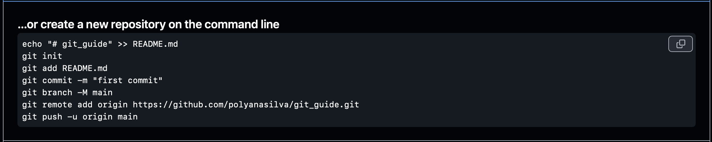
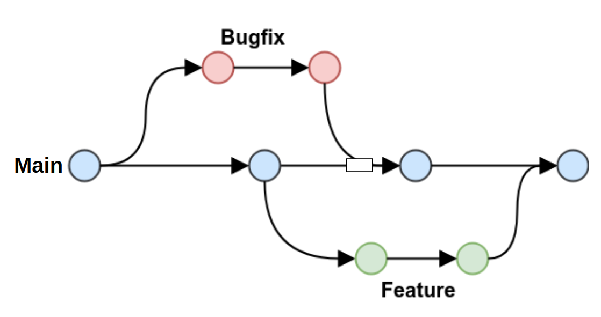

# Git e Github - Guia prático e rápido

## O que é Git?

O Git é um sistema de controle de versão. Podemos imaginá-lo como uma máquina do tempo do nosso projeto: ele permite salvar "fotografias" do estado atual do código em diferentes momentos. Cada uma dessas fotografias é chamada de commit. Assim, a cada etapa concluída do projeto, fazemos um commit para registrar as mudanças feitas. Isso nos permite rastrear, comparar e até reverter modificações ao longo do tempo.

link para um vídeo rápido que explica o que é Git/GitHub e como usar: https://www.youtube.com/watch?v=-l4Aa8wef8s&t=112s


## O que é o GitHub

O GitHub, por sua vez, é uma plataforma online onde podemos hospedar e gerenciar nossos repositórios Git. 

Ele funciona como uma nuvem para os projetos versionados com Git — assim, o que está salvo localmente no seu computador pode ser sincronizado com o GitHub para ficar disponível em qualquer lugar e para outras pessoas.

Além do armazenamento, o GitHub oferece várias ferramentas que facilitam o trabalho em equipe e o desenvolvimento colaborativo, como:

- Pull requests: para propor e revisar alterações no código;
- Issues: para registrar tarefas, bugs ou ideias de melhorias;
- Wikis e Documentações;
- GitHub Actions, que permitem automatizar testes e implantações.

Existem outras plataformas parecidas, como o GitLab e o Bitbucket, mas o GitHub é, atualmente, a mais popular e amplamente utilizada na comunidade de desenvolvedores.

## Tá, mas por que usar o Git/GitHub?
- **Organização e histórico:** mantenha o registro completo de todas as alterações feitas no projeto, podendo voltar a qualquer versão anterior.
- **Reprodutibilidade:** garante que qualquer pessoa consiga reproduzir exatamente o estado de um projeto em um determinado momento.
- **Trabalho em equipe:** facilita o desenvolvimento colabor ativo, permitindo que várias pessoas contribuam ao mesmo tempo.
- **Experimentação segura:** permite criar **ramificações (branches)** para testar novas ideias sem comprometer a versão principal do projeto.

## Como instalar o Git:
[Link](https://git-scm.com/downloads) para instalação do Git em cada sistema operacional.

no terminal podemos verificar se o git já foi instalado

```bash
git --version
```

Dica extra: Se você está em uma IDE ou no terminal, depois de instalado tente fechar e abrir novamente para assim usar o git normalmente.

## Configurações iniciais
Agora é importante que você crie uma conta no [Github](https://github.com).

As configurações a seguir serão feitas para conectar o nosso computador com a nossa conta do GitHub.

```bash
git config --global user.email "you@email.com"
git config --global user.name "Your Name"
```
Além disso, precisamos gerar uma chave SSH e adicionar no GitHub para fazer esse link, para isso digitamos o seguinte comando no terminal

```bash
ssh-keygen -t ed25519 -C "your_email@example.com"
```

será criado uma pasta oculta chamada .ssh, ao entrar nela um dos arquivos conterá a chave pública SSH que precisamos.

agora, temos que ir no nosso [github → settings → SSH and GPG keys](https://github.com/settings/keys). clicar em “New SSH key”, e adicionar a chave SSH Pública que geramos com o comando acima.

Para mais informações sobre essa chave SSH, pode ler na [documentação](https://docs.github.com/pt/authentication/connecting-to-github-with-ssh/generating-a-new-ssh-key-and-adding-it-to-the-ssh-agent).

## Criando um repositório

Na sua conta, clique no ícone verde “New" para criar um novo repositório.

Na página de criação, você pode definir:

- o nome do repositório,
- uma descrição opcional,
- se ele será público ou privado,
- e se deseja iniciar com um README (não indico adicionar nesse momento, por enquanto).

Após criar o repositório, o GitHub exibirá uma página com um tutorial de comandos básicos — é ali que aprendemos como conectar o repositório local (no nosso computador) com o repositório remoto (no GitHub).



Em seguida, abriremos o terminal **dentro da pasta do projeto que queremos versionar** e executaremos os comandos mostrados, prestando atenção às configurações iniciais. Para entender o que cada comando faz, siga as próximas etapas.


## Inicializando o Git no diretório

Para inicializar o git, ou seja, para converter um diretório existente no computador em um repositório Git, usamos o seguinte comando:
```bash
git init
```
Dica: confira se você, de fato, está no diretório que você quer adicionar no github.

Em seguida podemos ver o que tem dentro do repositório que ainda não foi para o repositório (como estamos iniciando agora, ele vai mostra tudo que tem dentro da pasta)
```bash
git status
```

Para adicionar os arquivos da nossa pasta local para o GitHub usamos:
```bash
git add <nome_do_arquivo_ou_pasta>
```

Ou então, podemos adicionar todos os arquivos:
```bash
git add .
```
Atenção: cuidado com o que você for adicionar aqui, evite adicionar dados grandes, porque o GitHub não suporta, ou dados sensíveis. Para ignorar esses arquivos/pastas que você não quer upar, tem um tópico falando sobre o gitignore mais a frente.

Para registrar as nossas adições, usamos o comando abaixo, que vai indicar o nome do nosso registro

```bash
git commit -m "nome_do_commit"
```

O nome do commit deve trazer uma pequena descrição das alterações feitas no código. Existem [boas práticas e convenções](https://github.com/iuricode/padroes-de-commits) que ajudam a padronizar esses nomes, assim fica mais fácil visualizar o propósito de cada mudança no histórico do projeto. 

A mensagem do commit ajuda, por exemplo, quando queremos voltar a um ponto específico do projeto, como antes de adicionar um filtro novo ou no momento em que integramos uma nova base de dados.

exemplo: 

```bash
git commit -m "feat: adiciona etapa de normalização log2 nas contagens"
```
Essa palavra inicial não é obrigatório, é apenas uma boa prática.


## O que é uma branch?
Agora precisamos informar em qual branch, ou seja, em qual ramificação do projeto queremos adicionar o nosso commit.        Para entender isso, vale lembrar como o sistema de versionamento do Git funciona.

Por padrão, todo repositório começa com uma branch principal, chamada main. Ela representa a versão estável do projeto — geralmente aquela que está funcionando corretamente e que será disponibilizada para os usuários.

Quando queremos fazer atualizações, corrigir erros ou testar novas funcionalidades sem correr o risco de quebrar o que já está funcionando, criamos novas branchs.

Essas branchs são cópias da main em que podemos trabalhar de forma isolada. Assim, todas as mudanças feitas ali não afetam o código principal até que estejam prontas e testadas.

Depois de revisar e testar tudo, podemos mesclar (merge) essa branch com a main, atualizando o projeto de forma segura.

Para iniciar o repositório, vamos só confirmar que queremos iniciar na branch main
```bash
git branch -M main
```

#### Comandos extras para criar ou alterar branchs
```bash
git branch #para ver quais branchs existem
git branch <nome_da_nova_branch> #para criar uma nova branch
git checkout <nome_da_branch> #para alterar para outra branch

# ou então, para criar e já mudar pra nova branch
git switch -c <nova_branch>
git checkout -b <nova_branch> 
```

## Agora, como conecta a pasta local com o repositório remoto?
Para conectar nosso repositório local com o nosso repositório online, usamos a chave https ou ssh com o comando:
```bash
git remote add origin <url_do_repositorio>
```

Depois de fazermos o link, podemos enviar para o github com o comando:
```bash
git push -u origin main
```
esse comando acima só é usado para a primeira vez que fazemos upload para esse repositório, nos próximos podemos usar apenas:
```bash
git push
```
